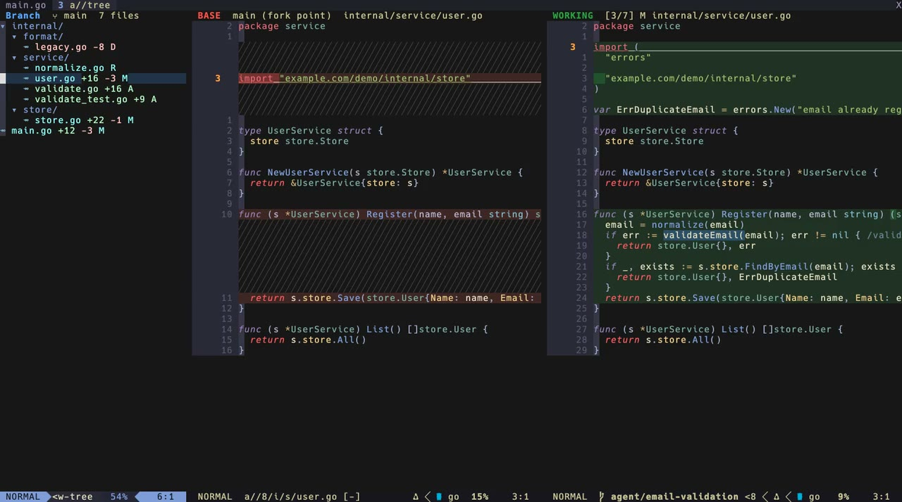
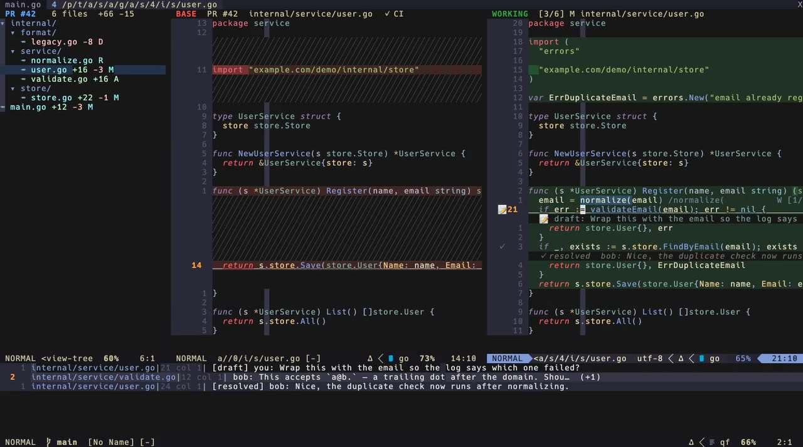

<div align="center">

# agent-review.nvim

[English](README.md) | 日本語

**AIエージェントが書いたコードを、LSPが動作するサイドバイサイド差分で確認できます。<br>ベース側はあなたがどこに移動しても追従します。**

[](https://github.com/tyzerrr/agent-review.nvim/actions/workflows/test.yml)


[](LICENSE)

[](assets/demo.mp4)

<sub>▶ 画像をクリックするとデモ動画が再生されます（54秒、mp4）</sub>

</div>

---

## なぜ必要か

コーディングエージェント（Claude Code、Codex、Cursorなど）は一度に多くのファイルを変更します。それを普通の差分ビューアで確認すると、エディタの最も便利な機能である **go to definition**（定義へ移動）や **find references**（参照検索）が使えず、新しいコードがコードベースの他の部分とどう噛み合っているかを確認できません。一方、ナビゲーションのためにファイルを普通に開くと、差分が見えなくなります。

`agent-review.nvim` は両方を同時に実現します。

```
┌ Uncommitted 6 files ┬─ BASE  HEAD  store.go ───────────┬─ WORKING  [5/6] M store.go ────────┐
│ ▾ internal/         │ type Store interface {           │ type Store interface {             │
│   ▾ store/          │   Save(u User) User              │   Save(u User) User                │
│       store.go +4 M │   All() []User                   │   All() []User                     │
│       user.go  +9 A │ ╱╱╱╱╱╱╱╱╱╱╱╱╱╱╱╱╱╱╱╱╱╱╱╱╱╱╱╱╱╱╱╱ │   FindByEmail(email string) … ◀ gd │
│   main.go   +2 -1 M │ }                                │ }                                  │
│ j/k: show the diff  │  read-only, at the base revision │  your real buffer: LSP, edit, save │
└─────────────────────┴──────────────────────────────────┴────────────────────────────────────┘
  changed files                                                       Claude Code terminal →
```

- **ファイルツリー**: 変更されたファイルをVS Codeのエクスプローラーのように並べます。カーソルを動かすと差分が切り替わり、`m`で「未コミットの変更」と「ブランチ全体」を切り替えられます。
- **右側**: 実際の作業ツリーのバッファです。言語サーバー、キーマップ、編集はすべて通常通り動作します。
- **左側**: 同じファイルのベースリビジョン（デフォルトは`HEAD`）の内容を、読み取り専用・シンタックスハイライト付きで表示します。
- **左が右に追従**: 右側で`gd`、`gr`、`<C-o>`、`:e`、`:cnext`を実行したり、Telescopeのエントリを選んだりすると、左側はそのファイルのベースリビジョンに切り替わり、カーソル位置も揃ったままになります。

## 機能

- 🧭 **LSP対応ナビゲーション**: ファイルをまたいで定義・参照・実装へ移動でき、差分もそれに追従します
- 🎨 **VSCode風の配色**: 削除行は赤、追加行は緑で表示され、変更された文字にはより強い色が付きます（`inline:char`、`linematch`）
- 🌳 **両側でのシンタックスハイライト**: ベース側でもtree-sitterが有効になりますが、LSPの診断は表示されません
- 🌲 **ファイルツリー**: 変更されたファイルを画面左にVS Codeのエクスプローラー風のツリーで表示し、ファイルごとにステータスと`+追加 -削除`行数を出します。`j`/`k`でたどると差分が切り替わります
- 🌿 **未コミットだけ／ブランチ全体**: まだコミットしていない変更だけを見るか、ブランチが`main`から分かれてからの変更すべて（コミット済みも含む）を見るかを`m`で切り替えられます
- 📋 **Quickfix連携**（任意）: 変更されたファイル（またはハンク）ごとにquickfixリストへ登録され、`]q`でレビュー全体を巡回し、両端で折り返します
- ✅ **既読マーク**: GitHubのプルリクエストの「Viewed」チェックボックスのように、ファイルをレビュー済みとしてマークできます。エージェントがそのファイルを再び変更すると、マークは自動的に外れます
- 🧪 **実装のみのレビュー**: テストファイル（Go、JS/TS、Python、Lua、Rustの慣習に基づく）をレビュー対象から外すオプションがあります
- 🔄 **自動更新**: エージェントがファイルを編集・作成・リバート・コミットすると、ツリー・バッファ・差分が自動的に更新されるため、レビューを開き直す必要はありません
- 🔭 **Telescopeピッカー**: 変更されたファイルとハンクをシンタックスハイライト付きのインライン差分プレビューで確認できます
- 🧹 **あらゆるgitステータスに対応**: 変更、追加、未追跡、削除、リネーム（旧パスとの差分）、gitignore対象、リポジトリ外のファイルすべてに対応します
- 🤖 **Claude Code連携**（[claudecode.nvim](https://github.com/coder/claudecode.nvim)）:
  - ベース側で行を選択して`<C-l>`を押すと、Claudeに送信できます
  - Claudeのターミナルはレビュータブに移動し、開閉やリサイズ時にウィンドウが再バランスされます
- 🛡️ **安全**: 作業ツリーへの書き込みは一切行わず、ベースのスナップショットは`.git/agent-review/`配下に保存されます。レビューを閉じても他のウィンドウ（Claudeターミナル、ヘルプ、他のファイル）は画面に残ります
- ⌨️ **完全にリマップ可能**: アクション単位のキー設定、キーのリスト、`false`での無効化、カスタムアクション、`<Plug>`マッピング、`User`イベントに対応します

## 必要環境

- Neovim **0.12以上**（`diffopt=inline:char`や`vim.lsp.enable`時代の挙動を利用します）
- `git`
- 任意:
  - [telescope.nvim](https://github.com/nvim-telescope/telescope.nvim)（ピッカー用。なければ`vim.ui.select`にフォールバックします）
  - [claudecode.nvim](https://github.com/coder/claudecode.nvim)（Claude Code連携用）
  - 利用する言語のtree-sitterパーサー

## インストール

### [lazy.nvim](https://github.com/folke/lazy.nvim)

```lua
{
  "tyzerrr/agent-review.nvim",
  event = "VeryLazy", -- keeps `:Telescope agent_review` available; plugin/ is tiny
  opts = {},
}
```

### その他のプラグインマネージャー

リポジトリを追加し、設定のどこかで`require("agent-review").setup()`を呼んでください。
コマンドと`<Plug>`マッピングは`setup()`なしでも動作しますが、デフォルトのグローバルキーマップは`setup()`を呼んだ時のみ作成されます。

## クイックスタート

1. エージェントに何かファイルを編集させます。
2. `<leader>dr`（または`:AgentReview`）を押します。新しいタブが開き、左から変更ファイルのツリー、ベース、作業ツリーが並びます。
3. ツリーで`j`/`k`を押してファイルをたどると、差分が切り替わります。`<CR>`で差分へ移ります。差分側では`]f`/`[f`で次／前のファイルへ移れます。
4. いつも通りナビゲーションします: `gd`、`gr`、`<C-o>`、`<leader>dl`。ベース側はそれに追従します。
5. ツリーで`m`を押すと、未コミットの変更だけでなくブランチ全体を見られます。
6. もう一度`<leader>dr`（またはツリーかベースウィンドウで`q`）を押すとレビューが閉じます。

`HEAD`以外のものに対してレビューする場合:

```vim
:AgentReview HEAD~3        " everything the agent committed in the last 3 commits, plus uncommitted work
:AgentReview origin/main   " the whole branch
```

`HEAD`のようなブランチ名が別のコミットに移動すると（あなたやエージェントがコミット・リセット・チェックアウトした場合）、ベースもそれに追従するため、コミットされた変更はレビューから外れます。コミットハッシュを直接指定した場合は固定されます。`auto_refresh.follow_base = false`を設定すると、レビューを開いた時点のコミットのままにできます。

## ファイルツリー

```
 Uncommitted  6 files  +31 -4
▾ internal/
  ▾ store/
      store.go       +4 M
      user.go        +9 A
  ▸ handler/
  main.go         +2 -1 M
  README.md          +3 M
```

- フォルダが先、ファイルが後で、VS Codeと同じく大文字小文字を区別せずに並びます。中身がフォルダ1つだけのフォルダは1行にまとめます（`lua/agent-review/`）。
- 各ファイルには行数とステータスが付きます: `M` 変更、`A` 追加、`U` 未追跡、`D` 削除、`R` リネーム。既読のファイルは`✓`付きで薄く表示されます。
- winbarにはモードと進み具合（`6 files`や`2/6 viewed`）が出ます。
- [mini.icons](https://github.com/echasnovski/mini.icons)か[nvim-web-devicons](https://github.com/nvim-tree/nvim-web-devicons)があれば、ファイルにアイコンが付きます。
- 右に表示中のファイルの行が強調され、`]f`・`gd`・ピッカーで移動するとツリーのカーソルも付いてきます。

| ツリーでのキー | 動作 |
| --- | --- |
| `j` / `k` | 移動すると、カーソル行のファイルの差分が右に出ます（フォーカスはツリーのまま） |
| `<CR>` / `o` | ファイル: 最初の変更箇所で差分へ移る。フォルダ: 畳む／開く |
| `<Tab>` | 既読マークの付け外し（フォルダなら中のファイルすべて） |
| `m` | 未コミットの変更 ⇔ ブランチ全体 の切り替え |
| `R` | 更新 |
| `q` | レビューを閉じる |

差分から`<leader>de`（または`:AgentReviewTree`）でツリーへ移り、もう一度押すと差分へ戻ります。ツリーの窓を閉じてもレビューは続き、`<leader>de`で再び開きます。
`tree = { follow_cursor = false }`にすると`<CR>`を押した時だけファイルを開き、`tree = { enabled = false }`にするとツリーを使いません。

## ブランチモード

デフォルトでは、まだコミットされていない変更（`HEAD`との差分）を表示するため、エージェントがコミットするとそのファイルはレビューから外れます。コミット済みかどうかに関係なく、ブランチでエージェントがしたことをすべて読みたい場合はブランチモードに切り替えます。

- ツリーで`m`、差分で`<leader>dm`、または`:AgentReviewMode`で2つのモードを切り替えます。
- `:AgentReviewBranch`でブランチモードのままレビューを開きます。`:AgentReviewBranch develop`のように別のブランチとも比べられます。
- 比較元は**分岐点**、つまり`HEAD`とメインブランチのmerge-baseです（プルリクエストの「Files changed」と同じ）。分岐した後に`main`へ入ったコミットは表示されません。
- メインブランチは`origin/HEAD`、`origin/main`、`origin/master`、`main`、`master`の順に自動で探します。`branch.base`（例: `"origin/develop"`）で指定することもできます。
- `main`上では、まだpushしていない変更（`origin/main`との差分）を表示します。
- 未コミットの変更が何も無い時に`<leader>dr`を押すと、そのままブランチモードで開くため、エージェントがコミットした内容も読めます。

エージェントがコミットした時の更新のされ方は、モードによって違います。

| | 未コミット | ブランチ |
| --- | --- | --- |
| エージェントがファイルを編集 | 一覧に出る／行数が更新される | 一覧に出る／行数が更新される |
| エージェントがファイルをコミット | レビューから外れる | 残る（ステータスは更新される。例: `U` → `A`） |
| 新しい`main`にrebase | — | 分岐点も一緒に移る |

## キーマップ

### デフォルト

| Scope | Key | Action |
| --- | --- | --- |
| global | `<leader>dr` | Toggle the review (`HEAD`) |
| global | `<leader>dR` | Type `:AgentReview ` so you can enter a revision |
| global | `<leader>dl` | Changed files picker |
| global | `<leader>dh` | Changed hunks picker |
| global | `<leader>dp` | GitHub pull requests (`:AgentReviewPR`) |
| tree | `j` / `k`, `<CR>` / `o`, `<Tab>`, `m`, `R`, `q` | See [ファイルツリー](#ファイルツリー) |
| review (both sides) | `<leader>de` | Move to the file tree / back to the diff |
| review (both sides) | `<leader>dm` | Switch between uncommitted changes and the whole branch |
| review (both sides) | `]f` / `[f` | Next / previous changed file |
| review (both sides + quickfix) | `]q` / `[q` | Next / previous quickfix entry, wrapping around at the ends |
| base side | `q` | Close the review |
| base side, visual | `<C-l>` | Send the selection to Claude Code |
| review (both sides) | `<leader>dv` | Mark the shown file as viewed / not viewed |
| review (both sides) | `<leader>dc` / `<leader>dC` | PR: comments on the cursor line / the PR conversation |
| review (both sides) | `<leader>da` (normal, visual) / `<leader>dS` | PR: draft a comment / submit the review |
| quickfix window | `<Tab>` | Mark the file under the cursor as viewed / not viewed |
| quickfix window | `<CR>` | Open the entry under the cursor in the review (even if another plugin maps `<CR>` globally) |

組み込みの差分モーションも使えます: `]c` / `[c`（次/前のハンク）。
作業側（右側）では、通常のマッピングがそのまま使えます。レビューが上書きしたバッファローカルなマッピングは、レビューを閉じると元に戻ります。
レビュータブの外や、agent-reviewが作成していないquickfixリストでは、これらのキーはagent-reviewがない場合と同じ動作をします。グローバルマッピングがあればそれが使われ（例えばflash.nvimの`<CR>`）、なければ組み込みコマンドが使われます。

### カスタマイズ

すべてのアクションは、キー（`"<leader>x"`）、キーのリスト（`{ "]f", "<Tab>" }`）、または`false`を受け取ります。

```lua
require("agent-review").setup({
  keymaps = {
    global = {
      toggle = "<leader>gr",            -- remap
      open_rev = false,                 -- disable
      files = { "<leader>df", "<F7>" }, -- several keys
      hunks = "<leader>dh",
    },
    review = {
      next_file = { "]f", "<Tab>" },
      prev_file = { "[f", "<S-Tab>" },
      -- any action can be put in any scope
      refresh = "<leader>du",
      quickfix_hunks = "<leader>dq",
      -- custom action: { key, function(session) ... end, desc = ..., mode = ... }
      copy_base_path = {
        "<leader>dy",
        function(session)
          vim.fn.setreg("+", session.root .. " @ " .. session.base_sha)
        end,
        desc = "Copy review base",
      },
    },
    base = {
      close = { "q", "<Esc>" },
      send_to_claude = "<C-l>",
    },
    quickfix = {
      qf_open = { "<CR>", "o" },
    },
  },
})
```

すべてのマッピングを`keymaps = false`で無効化し、`<Plug>`マッピングやLua APIから自分で構築することもできます。

```lua
require("agent-review").setup({ keymaps = false })
vim.keymap.set("n", "<leader>r", "<Plug>(agent-review-toggle)")
vim.keymap.set("n", "<Tab>", function() require("agent-review").next_file() end)
```

<details>
<summary>すべてのアクションと<code>&lt;Plug&gt;</code>マッピング</summary>

| Action | `<Plug>` mapping | Description |
| --- | --- | --- |
| `toggle` | `<Plug>(agent-review-toggle)` | Open / close the review |
| `open` | `<Plug>(agent-review-open)` | Open the review against the default base |
| `open_rev` | none | Type `:AgentReview ` on the command line |
| `close` | `<Plug>(agent-review-close)` | Close the review |
| `files` | `<Plug>(agent-review-files)` | Changed files picker |
| `hunks` | `<Plug>(agent-review-hunks)` | Changed hunks picker |
| `pr_list` | `<Plug>(agent-review-pr-list)` | GitHub pull requests |
| `next_file` | `<Plug>(agent-review-next-file)` | Next changed file |
| `prev_file` | `<Plug>(agent-review-prev-file)` | Previous changed file |
| `qf_next` | `<Plug>(agent-review-qf-next)` | Next quickfix entry; after the last one, go back to the first |
| `qf_prev` | `<Plug>(agent-review-qf-prev)` | Previous quickfix entry; before the first one, go to the last |
| `pr_thread` | `<Plug>(agent-review-pr-thread)` | PR: open the comment threads on the cursor line |
| `pr_conversation` | `<Plug>(agent-review-pr-conversation)` | PR: description, reviews and comments |
| `pr_comment` | `<Plug>(agent-review-pr-comment)` (normal, visual) | PR: draft a comment on the line(s) |
| `pr_submit` | `<Plug>(agent-review-pr-submit)` | PR: submit the drafted review |
| `toggle_viewed` | `<Plug>(agent-review-toggle-viewed)` | Mark the file as viewed / not viewed (tree / quickfix: the line under the cursor) |
| `toggle_mode` | `<Plug>(agent-review-toggle-mode)` | Switch between uncommitted changes and the whole branch |
| `open_branch` | `<Plug>(agent-review-open-branch)` | Open the review in branch mode |
| `tree_open` | `<Plug>(agent-review-tree-open)` | Tree: open the file under the cursor in the diff, or fold / unfold the folder |
| `tree_focus` | `<Plug>(agent-review-tree-focus)` | Move to the file tree (opening it if closed), or back to the diff |
| `qf_open` | `<Plug>(agent-review-qf-open)` | Open the review quickfix entry under the cursor in the working window |
| `refresh` | `<Plug>(agent-review-refresh)` | Reload the changed files and the diff |
| `quickfix_files` | `<Plug>(agent-review-quickfix-files)` | Quickfix: one entry per file |
| `quickfix_hunks` | `<Plug>(agent-review-quickfix-hunks)` | Quickfix: one entry per hunk |
| `send_to_claude` | `<Plug>(agent-review-send-to-claude)` (visual) | Send the base selection to Claude Code |

</details>

## コマンド

| Command | Description |
| --- | --- |
| `:AgentReview [rev]` | Open a review of the working tree against `rev` (default `HEAD`). Untracked files are included |
| `:AgentReviewBranch [branch]` | Review the whole branch since it left the main branch (or `branch`), committed and not |
| `:AgentReviewMode` | Switch between uncommitted changes and the whole branch |
| `:AgentReviewTree` | Move to the file tree (opening it if closed), or back to the diff |
| `:AgentReviewToggle [rev]` | Toggle the review |
| `:AgentReviewClose` | Close the review tab |
| `:AgentReviewFiles` | Pick a changed file |
| `:AgentReviewPR [preset\|number]` | List GitHub pull requests (the default lists, or a preset from `pr.presets`), or review PR `<number>` |
| `:AgentReviewPRClean` | Remove checked-out PRs that are not being reviewed |
| `:AgentReviewPRConversation` | Show the PR's description, reviews and comments |
| `:AgentReviewPRSubmit [approve\|request_changes\|comment]` | Send the drafted comments, replies and resolves in one request |
| `:AgentReviewHunks` | Pick a changed hunk |
| `:AgentReviewQuickfix [files\|hunks\|comments]` | Rebuild the quickfix list and open it (`comments`: PR review threads) |
| `:AgentReviewRefresh` | Reload the changed files and buffers now (normally done for you, see `auto_refresh`) |

## Telescope

`:Telescope agent_review`で拡張機能がオンデマンドに読み込まれます。明示的に読み込むには:

```lua
require("telescope").load_extension("agent_review")
```

| Picker | Description |
| --- | --- |
| `:Telescope agent_review` / `files` | Changed files with status and `+added -removed` counts |
| `:Telescope agent_review hunks` | Every hunk across all files; the preview scrolls to the hunk |

プレビューには作業ツリーのコードがtree-sitterハイライト付きで表示されます。追加行は緑で、削除行は赤でインライン表示され、**それぞれ独自のシンタックスハイライト**が付きます。
どちらのピッカーもレビューを開かずに使えます。エントリを選ぶと、その位置からレビューが開きます。
エントリは`filename`/`lnum`を持つため、Telescopeの`<C-q>`（quickfixへ送る）も使えます。

## Quickfix

デフォルトではファイルツリーがquickfixリストの代わりになります。`quickfix = { auto = true }`を設定するとレビューを開いた時にquickfixリスト（`Agent Review: HEAD`）にも登録され、`:AgentReviewQuickfix`でいつでも作れます。

```
internal/format/legacy.go|1 col 1| deleted   +0 -8
internal/service/normalize.go|1 col 1| renamed   +0 -0  (from internal/service/util.go)
internal/service/user.go|3 col 1| modified  +16 -3
```

- 各エントリは最初の変更行を指します。
- `:AgentReviewQuickfix hunks`で1ハンク1エントリの表示に切り替えられ、`]q`でレビュー内のすべての変更を巡回できます。
- quickfixウィンドウでの`<CR>`は、他のプラグイン（flash.nvimなど）が`<CR>`をグローバルにマップしていても、カーソル下のエントリをワーキングウィンドウで開きます。他のquickfixリストでは、あなた自身の`<CR>`がそのまま動作します。
- レビューウィンドウとquickfixウィンドウでは、`]q` / `[q`は端で折り返します。最後のエントリの次は最初に戻り、最初のエントリの前は最後に戻ります。カウント指定も使えます（`3]q`）。
- 更新時は新しいリストを積み上げるのではなく同じリストを更新し、選択中のエントリも維持されます。
- ベースウィンドウにフォーカスがある状態でquickfix、Telescope、`:e`から開かれたファイルは、自動的にワーキングウィンドウへ移動するため、レイアウトが崩れることはありません。

## Claude Code連携

[claudecode.nvim](https://github.com/coder/claudecode.nvim)をインストールしている場合:

- **ベースのコードを送信**: 左側で行を選択して`<C-l>`を押します。ベースのバージョンは`.git/agent-review/base-<sha>/<path>`（`.git`内なので作業ツリーはクリーンなまま）に書き出され、行範囲付きのファイルメンションとして送信されます。右側では通常の`ClaudeCodeSend`マッピングがそのまま使えます。
- **ターミナルがレビューに追従**: claudecode.nvimは他のタブに表示されているターミナルも「表示中」と判定するため、レビュータブからトグルすると、そこで隠れてしまいます。レビューが開くと、表示中のClaudeターミナルはレビュータブに移動し、レビューを閉じると元のタブに戻ります。レビュータブ内で開いたClaudeターミナルも同様に、元いたタブへ移動します。
- **他のウィンドウは維持される**: レビュータブ内で開いた、レビューの一部ではないウィンドウ（ヘルプ、別のファイル、他のエージェントのターミナルなど）は、戻るタブで再び開かれます。そのため、レビューを閉じても差分だけが閉じます。
- **バランスの取れたレイアウト**: Claudeターミナルの開閉やリサイズが行われると、2つの差分ウィンドウが再バランスされます。差分ウィンドウ自体を手動でリサイズした場合はそのままにされます。

## プルリクエスト

[](assets/demo-pr.mp4)

<sub>▶ 画像をクリックするとPRレビューのデモ動画が再生されます（64秒、mp4）。PRを選ぶ → スレッドを読む → 返信 → LSPで移動 → コメント → Viewed → 会話を読む → Approve までを、1回のリクエストで送ります。GitHubの代わりにローカルの仕組み（`scripts/demo/setup-pr.sh`）を使って録画しています。</sub>

誰のプルリクエストでも同じレイアウトでレビューできます。右側にPRのコード（言語サーバー付き）、左側にベース、quickfixに変更されたファイル一覧、そしてレビューコメントがそれぞれの行の上に表示されます。さらに、あなた自身のレビュー（コメント、返信、解決、承認）を1回のリクエストでGitHubに送信できます。

- `:AgentReviewPR 123`（または一覧から選択）でPR #123のレビューを開きます。
- 差分はGitHubの「Files changed」と同じです。ターゲットブランチとのマージベースとの差分です（マージ済みPRの場合は、GitHubが記録したターゲットブランチとの差分）。
- `:AgentReviewRefresh`でPRに新しくpushされたコミットを取り込みます。
- `:AgentReviewPRClean`でレビュー中でないチェックアウト済みPRを削除します。

### レビューコメント

- コメントが付いた行には、サインと、GitHubと同じく行のすぐ下に1行の要約が表示されます: `💬 bob: Why 2?  (+1)`。diffの反対側にも同じ数の空行が入るので、左右の並びはずれません。各作成者には常に同じ色が割り当てられます。削除行に対するコメントはベース（左）側に表示されます。解決済みのスレッドは薄く表示されます（`✓ resolved`）。
- `<leader>dc`でカーソル行上のすべてのスレッドをフローティングウィンドウ（markdown、`q`で閉じる）で開きます。
- そのウィンドウで`c`を押すと、スレッドを**Claude Code**に渡せます。会話はmarkdownファイルに書き出され、コメント対象の行とともに`@mentions`として送信されます。PRのブランチがあなたのworktreeのいずれかにチェックアウトされている場合、メンションはそのファイルを指すため、Claudeは実際のブランチを修正します。
- `<leader>dC` / `:AgentReviewPRConversation`で、説明文、レビュー（approved / requested changes）、コメントを時系列で表示します。
- `:AgentReviewQuickfix comments`は、すべてのスレッドを一覧表示します。未解決のスレッドが最初に、続いてoutdated（古いコミットへのコメントで、GitHub同様に行には配置されないもの）、最後に解決済みのスレッドが表示されます。削除行に関するコメントで`<CR>`を押すと、ベース側がその行にスクロールされた状態でファイルが開きます。
- これらはすべてPRごとに**1回**のGraphQLリクエストから取得されます（100スレッドを超える場合のみ追加リクエストが発生します）。`:AgentReviewRefresh`はPRが変化した場合のみ再度問い合わせます。それ以外の場合、PRのETagチェックは304を返すだけなので、コストはかかりません。

### 既読マークとCI

- 既読マーク（`<leader>dv`、quickfixの`<Tab>`）はGitHubのファイル単位の「Viewed」チェックボックスと同期します。github.com上でマークしたファイルはNeovim上でも既読として表示され、既読後に変更されたファイルは既読として表示されません。Neovim上でトグルしたマークは、`:AgentReviewPRSubmit`の実行時、またはレビューを閉じたときに1回のリクエストでまとめて送信されます。トグルごとに1回呼び出すわけではありません。
- ベース側のwinbarにはPRのheadのCI状態（`✓ CI`、`✗ CI failed`、`… CI running`）が表示され、PRの会話にはすべてのチェックがリンク付きで一覧表示されます。
- どちらもコメント取得のリクエストに相乗りするため、追加のAPI呼び出しは発生しません。

### レビューを書く

書いたものはすべて、まず**ドラフト**としてstateディレクトリ以下にPRごとに保存されます（Neovimを閉じても残ります）。送信すると、**1回のリクエスト**でGitHubに送られます。

- `<leader>da`でカーソル行、またはビジュアルモードで選択した行にコメントします。右側ではPRのコードに対してコメントし、左側では削除された側にコメントします。小さなmarkdownウィンドウが開きます: `:w`（または`<C-s>`）でドラフトを保存し、`q`でキャンセルします。同じ行で再度実行するとドラフトを編集でき、空の状態で保存するとドラフトは削除されます。GitHubは差分に表示されている行（変更箇所とその前後3行）へのコメントしか受け付けないため、それ以外の行は即座に拒否されます。
- スレッドウィンドウ（`<leader>dc`）内では: `r`で返信をドラフトし、`R`でスレッドの解決状態をトグルします。
- ドラフトはインラインで表示されます（`📝 draft: …`、`📝 draft reply`、`(will resolve)`）。また`:AgentReviewQuickfix comments`の先頭にも表示されます。
- `:AgentReviewPRSubmit approve` / `request_changes` / `comment`（または`<leader>dS`）でレビューの概要を入力するウィンドウが開きます。`:w`で、ドラフトしたすべてのコメント、返信、解決操作をまとめてレビューとして送信します。verdict（評価）を指定しない場合、ドラフトしたコメントは「Comment」レビューとして送信され、返信・解決のみの場合はそのまま送信されます。
- GitHubが一部を拒否した場合（例えば自分自身のPRを承認できない場合）、通った部分はドラフトから削除され、残りはドラフトに残るため、修正して再度送信できます。

### PRのコードの保存先

あなたのリポジトリには何も書き込まれません。worktreeもブランチもrefも、`.git`配下にも何も作成されません。

```
~/.local/state/agent-review/github.com/owner/repo/   ($XDG_STATE_HOME or pr.state_dir)
├── repo.git/   a private copy of your repository (cloned locally once, hard-linked, ~ the size of .git)
├── 123/        PR #123 checked out from it
└── 456/
```

- PRのコミットは`git fetch`で`repo.git`に取得されるため、差分の取得にAPI呼び出しは発生しません。GitHub APIを使うのはPRのメタデータ（タイトル、head、base）のみで、ETagを使うため変化のないPRはレート制限にカウントされません。
- headが変わっていないPRを再度開く場合、fetch自体がスキップされます（実際のリポジトリでは約1秒）。
- 言語サーバーは他のプロジェクトと同様にPRのチェックアウト上で動作します。未追跡の依存関係（例えば`node_modules`）はそこには存在しないため、TypeScriptサーバーなどはチェックアウト内にインストールする必要がある場合があります。

### プルリクエストの一覧表示

- `:AgentReviewPR`（または`<leader>dp`）で、Neovimを開いたリポジトリのプルリクエスト一覧を表示します。`origin`リモート（`pr.remote`）を使用し、[GitHub CLI](https://cli.github.com)（`gh auth login`）が必要です。
- デフォルトでは、**あなたが作成した**オープンなPRと、**あなたまたはあなたの所属するチーム**にレビューが依頼されているオープンなPRが表示されます。
- 各行には番号、タイトル、作成者、draft/merged/closedの状態、レビュー状態、CI、`+added -removed`、ファイル数、最終更新時刻が表示されます。プレビューには説明文が表示されます。
- `<CR>`でPRをレビュー用に開き、`<C-b>`（Telescope）でブラウザで開きます。

一覧はGitHubの検索構文ではなく、プレーンなキーで記述します。

```lua
require("agent-review").setup({
  pr = {
    -- each entry is one search; the results are merged without duplicates
    lists = {
      { author = "@me" },
      { reviewer = "@me" },           -- includes requests to your teams
    },
    state = "open",                   -- "open" | "closed" | "merged" | "all"
    presets = {                       -- :AgentReviewPR <name>
      team = { { reviewer = "@me", draft = false, base = "main" } },
      bugs = { { label = { "bug", "regression" } } },
      urgent = "is:open label:urgent", -- a raw GitHub query also works
    },
  },
})
```

キー: `author`、`reviewer`、`assignee`、`involves`、`mentions`、`label`（文字列またはリスト）、`base`、`head`、`draft`（`true`/`false`）、`state`（共通設定を上書き）。

すべての検索はGitHubへの**1回**のGraphQLリクエストにまとめられます。結果はstateディレクトリ配下にキャッシュされ、`pr.list_ttl`秒（デフォルト60秒）以内に再度開いた場合はリクエストが発生しません。それを過ぎると、まずキャッシュされたリストが即座に表示され、新しいリストが届いた時点で置き換わります。

## 既読マーク

GitHubのプルリクエストの「Viewed」チェックボックスのように、各ファイルをレビュー済みとしてマークできます。

- ツリー（またはquickfixウィンドウ）での`<Tab>`はカーソル下のファイル（フォルダなら中のファイルすべて）をトグルし、差分ウィンドウでの`<leader>dv`は表示中のファイルをトグルします。
- マークされたファイルはツリーで`✓`付きで薄く表示され、ツリーのwinbarに進捗（`3/8 viewed`）、差分のwinbarに`✓ viewed`と表示されます。quickfixでも`✓`が付き、タイトルに進捗が出ます。
- マークはファイルの内容を記憶します。エージェントがそのファイルを再び変更すると、マークは外れるため、変更された部分だけを読み直せます。
- マークは`.git/agent-review/viewed.json`（worktreeごと）に保存され、レビューを閉じて再度開いても保持されます。

## 実装のみのレビュー

多くの場合、見たいのはエージェントが書いた実装であり、書いたすべてのテストではありません。`tests.hide = true`を設定すると、テストファイルがツリー、quickfix、`]f`/`[f`、ピッカー、`[i/n]`カウントから除外されます。ツリーのwinbarには除外された件数が表示されます（`4 tests hidden`）。自分で開いたテストファイル（例えば`gd`経由）には、それでも差分が表示されます。

組み込みパターン:

| Language | Test files |
| --- | --- |
| Go | `*_test.go`, `testdata/` |
| JS / TS | `*.test.{js,jsx,ts,tsx,mjs,cjs,mts,cts}`, `*.spec.*` (same extensions), `__tests__/` |
| Python | `test_*.py`, `*_test.py`, `conftest.py`, `tests/` |
| Lua | `*_spec.lua`, `*_test.lua`, `test_*.lua`, `spec/`, `tests/` |
| Rust | `tests/` (integration tests), `*_test.rs`, `tests.rs` |

同じファイル内のユニットテスト（Rustの`#[cfg(test)] mod tests`など）はファイル単位で区別できないため、レビューに残ります。パターンは`"/" .. path`（リポジトリルートからの相対パス）に対してマッチするLuaパターンなので、`"^/e2e/"`はトップレベルの`e2e`ディレクトリにマッチします。

```lua
require("agent-review").setup({
  tests = { hide = true, extra_patterns = { "^/e2e/", "%.stories%.tsx$" } },
})
```

## 自動更新

レビューが開いている間、リポジトリはファイル変更を監視されます（`.git/`は無視されます）。エージェントがファイルを書き込むと、短いデバウンスの後にレビューが更新されます。

- 新しい変更はツリー（とquickfix）に追加されて行数も更新され、リバートされたファイルは除外されます。
- コミット後は、デフォルト（未コミット）のモードではベースが新しいコミットに移動するため、コミットされたファイルはレビューから外れます。[ブランチモード](#ブランチモード)ではファイルは残り、ステータスが更新されます。これは`git worktree`を使ったチェックアウト（refがワーキングディレクトリの外にある場合）でも動作します。
- 現在表示中のファイルが除外された場合（コミットまたはリバートされた場合）、両方のウィンドウはリスト内の次のファイル（quickfixを使っている場合はquickfixが選んでいるエントリ）に移動します。あなた自身が開いた、もともとリストに含まれていなかったファイル（例えば`gd`経由）は画面に残ります。何も残っていない場合は両方のウィンドウがクリアされ（winbarには「no changes」と表示されます）、レビューは開いたままになります。次にエージェントが変更を加えると、そこに自動的に表示されます。
- ディスク上で変更されたバッファは再読み込みされ（`:checktime`）、差分も再計算されます。
- `FocusGained`時と、ターミナルを離れたとき（`TermLeave`）にも更新されます。Linuxではファイル監視がトップレベルディレクトリのみをカバーするため、これらのイベントがその隙間を埋めます。

エージェントも変更したバッファに未保存の編集がある場合、Neovimは通常通りどちらを残すか確認します（`W12`）。何も黙って上書きされることはありません。
`auto_refresh = false`で無効化し、代わりに`:AgentReviewRefresh`を使ってください。

## 設定

<details open>
<summary>デフォルト</summary>

```lua
require("agent-review").setup({
  base = "HEAD",
  -- Applied only while a review is open and restored afterwards.
  -- Items your Neovim doesn't support are skipped.
  diffopt = { "internal", "filler", "closeoff", "inline:char", "linematch:60", "algorithm:histogram", "indent-heuristic" },
  fold_unchanged = false, -- true: fold unchanged regions like plain :diffthis
  fillchar = "╱",         -- filler shown opposite added/removed lines
  winbar = true,          -- " BASE  HEAD  path" / " WORKING  [3/6] M path"
  picker = "auto",        -- "auto" | "telescope" | "ui_select"
  tree = {
    enabled = true,       -- the changed-files tree on the left
    width = 32,
    follow_cursor = true, -- moving the cursor in the tree shows that file's diff
    icons = true,         -- file icons from mini.icons / nvim-web-devicons, if installed
  },
  branch = {
    base = nil,           -- branch mode compares with this branch; nil: origin/HEAD, origin/main, origin/master, main, master
    remote = "origin",
  },
  quickfix = {
    auto = false,         -- fill the quickfix list when the review opens
    open = true,          -- open the quickfix window in the review tab
    height = 8,
    mode = "files",       -- "files" | "hunks"
  },
  tests = {
    hide = false,         -- true: leave test files out of quickfix, ]f/[f and the pickers
    patterns = nil,       -- replace the built-in test file patterns (Lua patterns)
    extra_patterns = {},  -- add to the built-in patterns
  },
  auto_refresh = {        -- false to disable
    enabled = true,
    debounce = 200,       -- ms to wait so a burst of writes refreshes once
    follow_base = true,   -- move the base when HEAD (or the given ref) moves
  },
  keymaps = {
    global = { toggle = "<leader>dr", open_rev = "<leader>dR", files = "<leader>dl", hunks = "<leader>dh" },
    review = {
      next_file = "]f", prev_file = "[f", qf_next = "]q", qf_prev = "[q", toggle_viewed = "<leader>dv",
      toggle_mode = "<leader>dm", tree_focus = "<leader>de",
      pr_thread = "<leader>dc", pr_conversation = "<leader>dC", pr_comment = "<leader>da", pr_submit = "<leader>dS",
    },
    base = { close = "q", send_to_claude = "<C-l>" },
    tree = { tree_open = { "<CR>", "o" }, toggle_viewed = "<Tab>", toggle_mode = "m", refresh = "R", close = "q" },
    quickfix = { qf_open = "<CR>", toggle_viewed = "<Tab>" }, -- only in the review tab's quickfix window
  },
  pr = {
    gh = "gh",            -- GitHub CLI
    state_dir = nil,      -- default: $XDG_STATE_HOME/agent-review or ~/.local/state/agent-review
    remote = "origin",    -- the remote whose GitHub repository has the PRs ("upstream" for forks)
    lists = { { author = "@me" }, { reviewer = "@me" } },
    state = "open",
    presets = {},
    list_ttl = 60,        -- seconds a cached PR list is used without asking GitHub
    limit = 50,           -- PRs per search
    comment_sign = "💬",  -- sign on lines with review comments
    resolved_sign = "✓",
    draft_sign = "📝",
  },
  claude = {
    focus_after_send = true,     -- jump into the Claude terminal after <C-l>
    terminal_pattern = "claude", -- how the Claude terminal buffer is recognized
    follow_terminal = true,      -- move the Claude terminal into the review tab
  },
  highlights = {},               -- see below
})
```

</details>

### ハイライト

デフォルトでは、色はあなたの`Normal`の背景色から導出されるため、どのカラースキームでも馴染みます。上書きすることもできます。

```lua
require("agent-review").setup({
  highlights = {
    AgentReviewAdd = { bg = "#1f3a28" },
    AgentReviewDelete = { bg = "#3d1f24" },
  },
})
```

| Group | Used for |
| --- | --- |
| `AgentReviewAdd` / `AgentReviewAddText` | Added or changed lines on the working side / the changed characters |
| `AgentReviewDelete` / `AgentReviewDeleteText` | Removed or changed lines on the base side / the changed characters |
| `AgentReviewFiller` | The `╱╱╱` filler opposite one-sided lines |
| `AgentReviewWinbarBase` / `AgentReviewWinbarWork` | `BASE` / `WORKING` labels in the winbar |
| `AgentReviewTreeModified` / `Added` / `Renamed` / `Deleted` | File names in the tree, by status (link to `Changed` / `Added` / `Removed`) |
| `AgentReviewTreeAddedCount` / `AgentReviewTreeRemovedCount` | `+n` / `-n` in the tree |
| `AgentReviewTreeDir` / `AgentReviewTreeViewed` / `AgentReviewTreeCurrent` | Folders / viewed files / the file shown on the right |
| `AgentReviewTreeMode` / `AgentReviewTreeModeBranch` | The mode label in the tree's winbar |

## Lua API

```lua
local ar = require("agent-review")

ar.setup(opts)
ar.open(base?, { path? })   -- open (or focus) a review, optionally at a root-relative path
ar.open_at(path, lnum?)     -- open the review at a file and line (used by the pickers)
ar.close()
ar.toggle(base?)
ar.open_branch(branch?)     -- review the whole branch since it left the main branch
ar.toggle_mode()            -- uncommitted <-> whole branch
ar.tree_focus()             -- move to the file tree / back to the diff
ar.next_file() / ar.prev_file()
ar.files() / ar.hunks()     -- pickers
ar.quickfix("files" | "hunks")
ar.qf_next() / ar.qf_prev() -- quickfix, wrapping around
ar.toggle_viewed()          -- mark the file as viewed / not viewed
ar.refresh()
```

### イベント

```lua
vim.api.nvim_create_autocmd("User", {
  pattern = { "AgentReviewOpen", "AgentReviewClose" },
  callback = function(ev)
    -- ev.data = { root, base, base_sha, mode, tab, left_win, right_win }
  end,
})
```

## 仕組み

- 右側のウィンドウは実際のファイルバッファを表示するため、言語サーバーは通常通り接続します。
- 左側のウィンドウは、`git show <base>:<path>`から構築された`nofile`のスクラッチバッファを表示します。NeovimのLSP自動接続はこれらをスキップするため、診断が重複することはありません。
- 右側ウィンドウの`BufWinEnter`/`BufEnter`autocmdが左側を再構築し、両側に`:diffthis`を再実行します。ペアが変わるたびに、まず`:diffoff!`で隠れたバッファをクリアし、Neovimの8バッファ差分制限（`E96`）に達しないようにしています。
- リポジトリ外のファイルやgitignore対象のファイルは差分がオフになり、新規ファイルは空のベースになります。

## FAQ

<details>
<summary>左側で<code>gd</code>が動かないのはなぜですか？</summary>

ベース側はディスク上のファイルではなくスナップショットのため、言語サーバーは接続されていません。
右側でナビゲーションしてください。左側がそれに追従します。
</details>

<details>
<summary>レビューを開いた後にエージェントがさらにファイルを変更した</summary>

`]f`、ピッカー、quickfixリストは自動的に新しいファイルを検知します。`:AgentReviewRefresh`を実行すると、カウントが更新され、変更されたバッファも再読み込みされます。
</details>

<details>
<summary>ツリーの代わりにquickfixリストを使えますか？</summary>

使えます。`tree = { enabled = false }, quickfix = { auto = true }`で以前のレイアウトになります。`quickfix = { open = false }`ならウィンドウを開かずにリストだけを作ります。
</details>

<details>
<summary>エージェントが全部コミットしてレビューが空になった</summary>

未コミットのモードが正しく動いている状態です。ツリーで`m`（または`<leader>dm`）を押すと、コミットされたものも含めてブランチ全体を見られます。
</details>

## 開発

```sh
make test                                   # all tests (mini.test, headless; clones test deps into ./deps)
make test-file FILE=tests/test_session.lua  # a single file
nix shell nixpkgs#vhs nixpkgs#ttyd nixpkgs#ffmpeg -c scripts/demo/render.sh  # re-record assets/demo.mp4
nix shell nixpkgs#vhs nixpkgs#ttyd nixpkgs#ffmpeg -c scripts/demo/render.sh scripts/demo/demo-pr.tape assets/demo-pr.mp4  # PRレビューのデモ
```

テストは一時ディレクトリに作られた実際のgitリポジトリに対して実行されます。外部プラグイン（claudecode.nvim）のみがスタブ化されています。

## ライセンス

MIT
